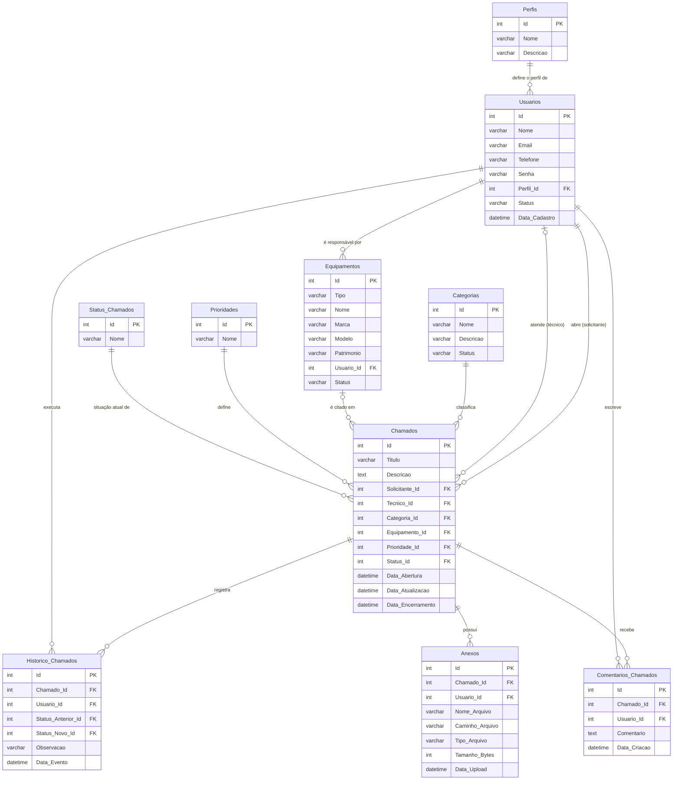

# Banco de dados do SecureDesk

Modelo de dados do sistema em MySQL/MariaDB. A API grava os mesmos dados em `server/db.json`; os scripts desta pasta representam esse modelo em SQL e trazem a mesma massa de dados da demonstração.

## Como executar

Rode os scripts nesta ordem, no MySQL Workbench, no DBeaver ou pelo terminal:

```bash
mysql -u root -p < 01_criacao_banco.sql
mysql -u root -p < 02_dados_iniciais.sql
mysql -u root -p < 03_consultas.sql
```

| Script | O que faz |
|--------|-----------|
| `01_criacao_banco.sql` | Cria o banco `SecureDesk` e as tabelas. Pode ser rodado de novo: apaga as tabelas e recria. |
| `02_dados_iniciais.sql` | Insere 9 usuários, 9 categorias, 12 equipamentos e 40 chamados com histórico e comentários. |
| `03_consultas.sql` | 16 consultas, incluindo as que reproduzem os números do dashboard e dos relatórios. |

Senha de todos os usuários: `123456` (gravada com hash bcrypt, o mesmo formato da API).

## Diagrama entidade-relacionamento



## Tabelas de domínio

| Tabela | Valores |
|--------|---------|
| Perfis | Cliente, Técnico, Administrador |
| Prioridades | Baixa, Média, Alta, Crítica |
| Status_Chamados | Aberto, Em análise, Em atendimento, Aguardando usuário, Resolvido, Encerrado, Cancelado |

A reabertura de um chamado não é um status próprio: ela fica registrada no `Historico_Chamados`, e o chamado volta para "Em atendimento".

## Regras do modelo

- O e-mail do usuário, o número de patrimônio do equipamento e o nome da categoria são únicos.
- Usuários e equipamentos não são apagados, só ficam com status `Inativo`, para não quebrar o histórico dos chamados.
- `Data_Atualizacao` do chamado é atualizada automaticamente a cada alteração (`ON UPDATE CURRENT_TIMESTAMP`).
- Toda mudança de status gera uma linha em `Historico_Chamados` com quem fez, o status anterior, o novo e a observação.
